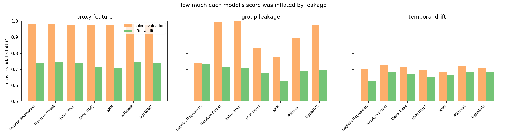
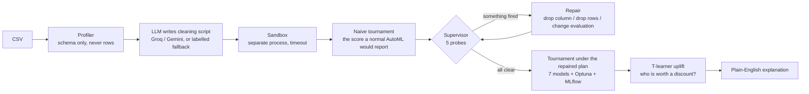
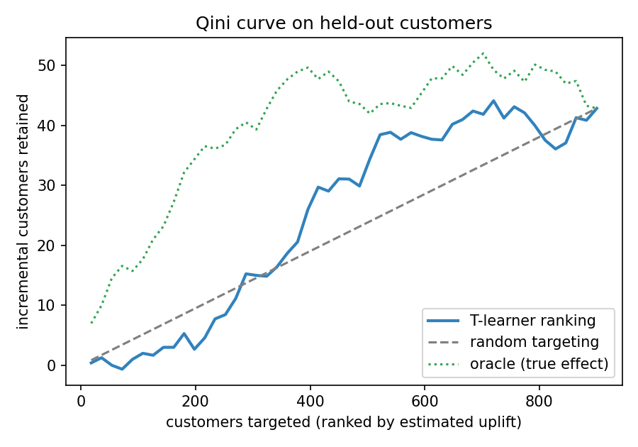

# Rubicon

**The AutoML pipeline that tries to break its own score before believing it.**

Every AutoML tool maximises a validation score. Rubicon treats a good score as a
suspect: before any model is trusted, a supervisor runs five cheap probes that
ask *"would this number survive if I evaluated it honestly?"*, names the kind of
data leakage it finds, repairs it, and only then runs the model tournament and
the uplift model. The whole thing is a LangGraph workflow with a real
probe → repair loop, an LLM that writes the cleaning code in a sandbox, Optuna
tuning, MLflow tracking, a Streamlit dashboard and an MCP server.

**Headline result, measured.** Under group leakage (the same customer in train
and test), Extra Trees scores **0.998** AUC and Random Forest **0.993**, while
logistic regression scores 0.742. Evaluated honestly, the trees collapse to
~0.70 and **logistic regression wins at 0.732 — it barely moved.** The flexible
models weren't learning churn; they were memorising customers. This is the
pattern Kapoor & Narayanan found across hundreds of published ML papers, and
Rubicon detects and reverses it automatically.



---

## How it works



### The five probes

Each probe is a few lines of code that compares the score you'd naively report
with the score you'd get under a stricter evaluation. If the gap is large, the
naive score was lying.

| probe | question it asks | fires when | fix |
|---|---|---|---|
| proxy feature | does any *single* column predict the target almost perfectly? | single-feature AUC ≥ 0.95 | drop the column |
| exact duplicates | are rows copied, so folds share rows? | ≥ 2% duplicate rows | de-duplicate before splitting |
| near-duplicates | were rows copied and jittered (augmentation before the split)? | ≥ 5% rows have a twin with a different id | remove the twins |
| group leakage | does the score collapse when the same entity is kept out of both folds? | stratified-vs-GroupKFold gap ≥ 0.05 | group-aware CV |
| temporal drift | does the score collapse when the model must predict the *future*? | random-CV vs forward-split gap ≥ 0.05 | forward-chaining evaluation |

Probes are re-run after every repair against the *current* evaluation plan, so
one kind of leakage can't masquerade as another (group leakage inflates the
random-CV reference that the temporal probe uses, for example).

These map onto the leakage taxonomy in Kapoor & Narayanan, *Leakage and the
reproducibility crisis in machine-learning-based science* (Patterns, 2023):
illegitimate features (L2), train/test non-independence (L1), and a test set
that isn't the deployment distribution (L3).

---

## Results

Everything below was produced by the code in this repo on a 2016 MacBook Pro;
`results/*.json` are the raw outputs. The committed showcase ran in **LLM mode**
with Groq's `openai/gpt-oss-120b` writing the cleaning scripts (~760 prompt +
~490 completion tokens per dataset, as reported by the API) and the audit
explanations. The schema profile the model sees is ~300 tokens; it never sees
a row.

### 1. Can the supervisor name the bug? — 6 cases × 10 seeds

`testbed.py` generates clean synthetic churn data and plants exactly one kind of
leakage. The supervisor sees only the data.

| planted | detected | exact diagnosis | false alarms | rounds |
|---|---|---|---|---|
| nothing (clean) | — | — | **0%** | 1.0 |
| proxy feature | 100% | 100% | 0% | 2.0 |
| exact duplicates | 100% | 100% | 0% | 2.0 |
| near-duplicates | 100% | 100% | 0% | 2.3 |
| group leakage | 100% | 100% | 0% | 2.0 |
| temporal drift | 100% | 100% | 0% | 2.0 |

*Exact diagnosis* means the supervisor fired on the planted type and nothing
else. 60 runs, 1,500 rows each, 4.1 minutes on a laptop CPU.

### 2. How much was each model's score inflated? — full pipeline, three cases

The same seven models, cross-validated the naive way and then under the repaired
plan. The gap is what a normal AutoML run would have over-promised.

| model | proxy feature<br/>naive → repaired | group leakage<br/>naive → repaired | temporal drift<br/>naive → repaired |
|---|---|---|---|
| Logistic Regression | 0.984 → 0.693 | 0.742 → **0.732** (−0.01) | 0.701 → 0.629 |
| Random Forest | 0.979 → 0.732 | 0.993 → 0.714 (−0.28) | 0.724 → 0.681 |
| Extra Trees | 0.979 → 0.732 | **0.998** → 0.706 (−0.29) | 0.713 → 0.671 |
| SVM (RBF) | 0.974 → 0.711 | 0.833 → 0.676 | 0.693 → 0.649 |
| KNN | 0.975 → 0.707 | 0.775 → 0.629 | 0.684 → 0.666 |
| XGBoost | 0.981 → **0.744** | 0.892 → 0.691 | 0.719 → **0.683** |
| LightGBM | 0.979 → 0.733 | 0.976 → 0.695 | 0.707 → 0.681 |
| Optuna winner | XGBoost 0.754 | Logistic Regression 0.732 | XGBoost 0.691 |

Three different stories in one table. A proxy feature inflates *everything*
equally (any model can read a column that is the answer). Group leakage inflates
*flexible models most* — the trees memorise customers, logistic regression
can't — so the leaderboard order flips once it's fixed. Temporal drift inflates
modestly but uniformly, and no amount of tuning recovers it, because the
future really is different from the past.

### 3. Who is worth a discount? — uplift on held-out data

A T-learner estimates each customer's Individual Treatment Effect of the
retention discount. Because the testbed knows the *true* effect, the policy
can be scored honestly: target the top 25% by estimated uplift, then count
what the discount would really have saved, against random targeting and an
oracle that knows the truth.

| case | split | Spearman vs true effect | normalised Qini | budget lift vs random | share of oracle |
|---|---|---|---|---|---|
| proxy feature | stratified | 0.22 | 0.16 | **+92%** | 59% |
| group leakage | group-aware | 0.23 | 0.52 | **+76%** | 55% |
| temporal drift | forward in time | −0.04 | 0.07 | **−2%** | 33% |



The third row is the honest one: when the test set is the *future* and the
data has drifted, the uplift policy loses to random targeting (−2%) and its
ranking is uncorrelated with the true effect. The split honours the repaired
plan, so this failure is visible instead of hidden — a random split would have
reported a healthy lift here too.

---

## Run it

```bash
pip install -r requirements.txt
python experiments/run_all.py      # detection benchmark + showcase + figures, ~8 min
streamlit run app.py               # dashboard: plant a bug, watch it get caught
python mcp_server.py               # MCP server on http://127.0.0.1:8000/mcp
```

### LLM mode

Copy `.env.example` to `.env` and add a **Groq** or **Gemini** key. The model
then writes the pandas cleaning script from the schema profile (it never sees
rows) and explains the audit in plain English; the response's own `usage`
field is what gets reported as token count. Without a key every run is
labelled `mode=fallback` and uses a fixed template. The default model is
`openai/gpt-oss-120b` on Groq; if your provider retires it, set
`RUBICON_LLM_MODEL` to any current chat model.

The LLM-written script runs in a separate OS process with a timeout; if it
fails or doesn't produce a valid file, Rubicon logs that and falls back.

---

## Layout

```
rubicon/
  testbed.py      clean synthetic churn + true treatment effect; five leakage planters
  probes.py       the five probes
  supervisor.py   probe -> repair loop
  llm.py          Groq/Gemini client, cleaning-script generation, explanations, fallback
  tools.py        schema profiler, subprocess sandbox
  tournament.py   7 models, Optuna on the winner, MLflow (sqlite)
  causal.py       T-learner, Qini, budget simulation scored on the true effect
  graph.py        the LangGraph workflow
experiments/      run_testbed_eval.py  run_showcase.py  make_figures.py  run_all.py
app.py            Streamlit dashboard
mcp_server.py     MCP tool: audit_dataset(csv_path, target, treatment, ...)
results/          raw JSON from the committed runs + figures
```

## Limitations

- The testbed is synthetic. It proves the probes catch the bugs they were
  designed to catch, with zero false alarms on 60 runs; it does not prove they
  catch every leakage pattern in real data.
- The temporal probe uses a single forward split and operates near its noise
  floor (gap threshold 0.05). During development, a variant of the testbed with
  a weaker treatment effect produced threshold-boundary false alarms from this
  probe alone. A bootstrapped version is the obvious upgrade.
- The T-learner is a baseline uplift model (gradient boosting per arm) and
  recovers only part of the achievable uplift (55–59% of the oracle's saved
  value where it works). X-learners or causal forests would do better; the
  evaluation harness is the contribution, not the learner.
- The LLM explanation narrates every probe that fired in round 1. In the group
  case the temporal probe also fired, because group leakage inflates the
  random-CV reference it compares against; it cleared once the group fix was
  applied, but the prose calls it a second problem. The numbers are right; the
  prompt could be tighter.
- Probe thresholds are fixed constants, chosen before the benchmark and reported
  so they can be criticised.

## Background

- Kapoor & Narayanan, *Leakage and the reproducibility crisis in
  machine-learning-based science*, Patterns 4(9), 2023 — the taxonomy, and the
  civil-war-prediction case where complex models' advantage over logistic
  regression vanished once leakage was fixed.
- Kaufman, Rosset, Perlich & Stitelman, *Leakage in data mining: formulation,
  detection, and avoidance* — detecting leakage from the data itself.
- Hollmann et al., *CAAFE* (2023) and Hong et al., *Data Interpreter* (2024) —
  LLMs writing data-science code that is executed and verified in a loop.
- Künzel et al., *Metalearners for estimating heterogeneous treatment effects*,
  PNAS 2019 — the T-learner.

MIT licensed.
